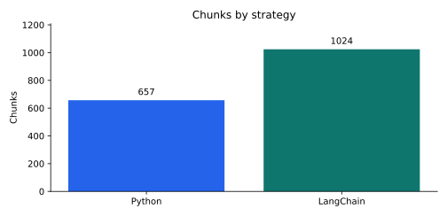

# RAG по научным публикациям

[← Все проекты](../../README.md) · [Ноутбук](notebook.ipynb) · [Открыть в Colab](https://colab.research.google.com/github/Xokage9/ml-portfolio/blob/main/projects/01_rag/notebook.ipynb)

Построить поиск по научным публикациям и сравнить ответы локальной языковой модели с ответами на основе найденных фрагментов.

## Что реализовано

Две стратегии чанкинга, нормализованные эмбеддинги, FAISS, исправление опечаток, проверка утверждений и отказ при отсутствии релевантных источников.

## Данные

Корпус загружается через arXiv API и сохраняется в `rag_lab3_variant1/articles.jsonl`. Достаточно интернет-соединения; собственные API-ключи не нужны.

## Запуск

Из корня репозитория выполните:

```bash
python -m pip install -r projects/01_rag/requirements.txt jupyterlab
cd projects/01_rag
python -m jupyter lab notebook.ipynb
```

В Colab откройте ссылку выше, выполните ячейку установки и разместите исходные данные в рабочем каталоге. Для полного обучения и генерации нужен подходящий GPU; подготовка данных и часть анализа работают на CPU. Зависимости заданы диапазонами, это не lock-файл конкретного CUDA-окружения.

## Проверка качества

350 статей в сохранённом запуске; 657 фрагментов Python и 1024 LangChain. Пять сценариев на каждый вариант. Статус `validated` относится к проверке отдельных утверждений, а не к полноте или безошибочности всего ответа.

## Зафиксированный результат

350 статей; две стратегии чанкинга; по 4 ответа с подтверждёнными утверждениями и одному отказу на 5 сценариев.

Данные взяты из сохранённых выводов исходной работы. Полный запуск обновлённой версии на GPU не выполнялся. Метрики нового запуска должны сохраняться отдельно от [истории эксперимента](results/recorded_metrics.json).

## Ограничения

Набор из пяти запросов — качественная проверка, а не независимый бенчмарк. Эвристики и NLI-проверка не гарантируют отсутствие галлюцинаций.


## График исходного эксперимента



Диаграмма построена по числам из recorded_metrics.json; это не результат повторного запуска.
