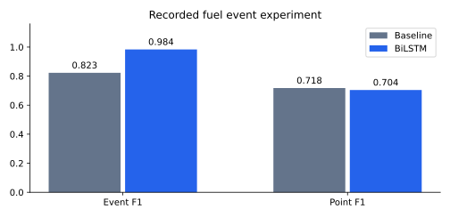

# Детекция заправок по временным рядам

[← Все проекты](../../README.md) · [Ноутбук](notebook.ipynb) · [Открыть в Colab](https://colab.research.google.com/github/Xokage9/ml-portfolio/blob/main/projects/02_fuel_events/notebook.ipynb)

Находить события заправки по телеметрии датчика уровня топлива, а не только классифицировать отдельные временные точки.

## Что реализовано

LSTM и BiLSTM, признаки при пропадании сигнала, семь конфигураций на трёх seed, разделение по машинам и выбор порога на validation.

## Данные

Учебные CSV загружаются из [fuel-refuel-lab](https://github.com/hehehelp123/fuel-refuel-lab). Данные и исходная постановка принадлежат указанному источнику. Файл `fuel_5min.csv` можно положить рядом с ноутбуком.

## Запуск

Из корня репозитория выполните:

```bash
python -m pip install -r projects/02_fuel_events/requirements.txt jupyterlab
cd projects/02_fuel_events
python -m jupyter lab notebook.ipynb
```

В Colab откройте ссылку выше, выполните ячейку установки и разместите исходные данные в рабочем каталоге. Для полного обучения и генерации нужен подходящий GPU; подготовка данных и часть анализа работают на CPU. Зависимости заданы диапазонами, это не lock-файл конкретного CUDA-окружения.

## Проверка качества

Сравнение выполняется на одном наборе временных точек тестовых машин. Конфигурация и порог выбираются на validation; проверяются событийный и точечный F1. В репозитории отсутствуют старые pickle-кэши, повторное обучение включено по умолчанию.

## Зафиксированный результат

Сохранённый эксперимент: event F1 0.8226 → 0.9836; point F1 0.7179 → 0.7042.

Данные взяты из сохранённых выводов исходной работы. Полный запуск обновлённой версии на GPU не выполнялся. Метрики нового запуска должны сохраняться отдельно от [истории эксперимента](results/recorded_metrics.json).

## Ограничения

Рост событийного F1 сопровождается снижением точечного F1. Цифры относятся к конкретным данным и протоколу. BiLSTM с центральным окном использует будущие точки и подходит для офлайн-анализа или работы с задержкой.


## График исходного эксперимента



Диаграмма построена по числам из recorded_metrics.json; это не результат повторного запуска.
