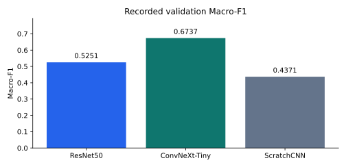

# Классификация цвета автомобилей

[← Все проекты](../../README.md) · [Ноутбук](notebook.ipynb) · [Открыть в Colab](https://colab.research.google.com/github/Xokage9/ml-portfolio/blob/main/projects/05_transfer_learning/notebook.ipynb)

Сравнить предобученные ResNet50 и ConvNeXt-Tiny с небольшой CNN, обучаемой с нуля, на несбалансированной классификации цветов.

## Что реализовано

Подготовка таблицы изображений, удаление редких классов, стратифицированное разбиение, аугментации, fine-tuning и сравнение по Macro-F1.

## Данные

Исходные изображения не распространяются. Положите `Image_table.csv` и каталог `confirmed_fronts/` в `data/car_colors/1/`. В CSV требуется `Image_name`; метка цвета извлекается из имени с разделителем `$$`. Используйте разрешённый вам исходный учебный набор.

## Запуск

Из корня репозитория выполните:

```bash
python -m pip install -r projects/05_transfer_learning/requirements.txt jupyterlab
cd projects/05_transfer_learning
python -m jupyter lab notebook.ipynb
```

В Colab откройте ссылку выше, выполните ячейку установки и разместите исходные данные в рабочем каталоге. Для полного обучения и генерации нужен подходящий GPU; подготовка данных и часть анализа работают на CPU. Зависимости заданы диапазонами, это не lock-файл конкретного CUDA-окружения.

## Проверка качества

Сохранённый эксперимент: 61 825 изображений, 21 класс, разбиение train/validation 80/20. Таблицы новой версии строятся из `validate`, а кривые — из истории обучения. Копия лучшего state_dict теперь независима от следующих шагов обучения.

## Зафиксированный результат

Сохранённая validation Macro-F1: ResNet50 0.5251, ConvNeXt-Tiny 0.6737, ScratchCNN 0.4371.

Данные взяты из сохранённых выводов исходной работы. Полный запуск обновлённой версии на GPU не выполнялся. Метрики нового запуска должны сохраняться отдельно от [истории эксперимента](results/recorded_metrics.json).

## Ограничения

Независимая test-выборка в исходной работе отсутствует. После исправления checkpoint результаты нужно получить заново; старые числа сохранены отдельно как история эксперимента.


## График исходного эксперимента



Диаграмма построена по числам из recorded_metrics.json; это не результат повторного запуска.
