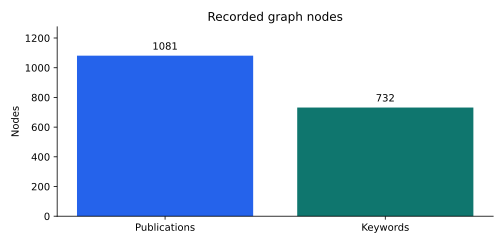

# Графовый анализ научных публикаций

[← Все проекты](../../README.md) · [Ноутбук](notebook.ipynb) · [Открыть в Colab](https://colab.research.google.com/github/Xokage9/ml-portfolio/blob/main/projects/06_graph_search/notebook.ipynb)

Собрать корпус статей о GraphRAG, построить графы терминов и публикаций, выделить сообщества и сравнить варианты поиска.

## Что реализовано

arXiv API с повторами запросов, извлечение терминов, TF-IDF и косинусное сходство, центральности и поиск сообществ.

## Данные

Корпус загружается через arXiv API и кэшируется в `graph_rag_arxiv.csv`. Для английских терминов нужна модель spaCy `en_core_web_sm`; команда установки приведена в ноутбуке.

## Запуск

Из корня репозитория выполните:

```bash
python -m pip install -r projects/06_graph_search/requirements.txt jupyterlab
cd projects/06_graph_search
python -m jupyter lab notebook.ipynb
```

В Colab откройте ссылку выше, выполните ячейку установки и разместите исходные данные в рабочем каталоге. Для полного обучения и генерации нужен подходящий GPU; подготовка данных и часть анализа работают на CPU. Зависимости заданы диапазонами, это не lock-файл конкретного CUDA-окружения.

## Проверка качества

В сохранённом запуске: 1081 публикация, 732 термина и 15 сообществ. Это анализ графа документов и терминов, а не реализация Microsoft GraphRAG. Ограничение даты корпуса фиксировано в конфигурации.

## Зафиксированный результат

1081 статья; 732 узла терминов; 3125 связей терминов; 15 сообществ.

Данные взяты из сохранённых выводов исходной работы. Полный запуск обновлённой версии на GPU не выполнялся. Метрики нового запуска должны сохраняться отдельно от [истории эксперимента](results/recorded_metrics.json).

## Ограничения

Состав корпуса зависит от даты и ответа arXiv. Кластеры и центральности описывают собранный корпус, а не всю научную область.


## График исходного эксперимента



Диаграмма построена по числам из recorded_metrics.json; это не результат повторного запуска.
